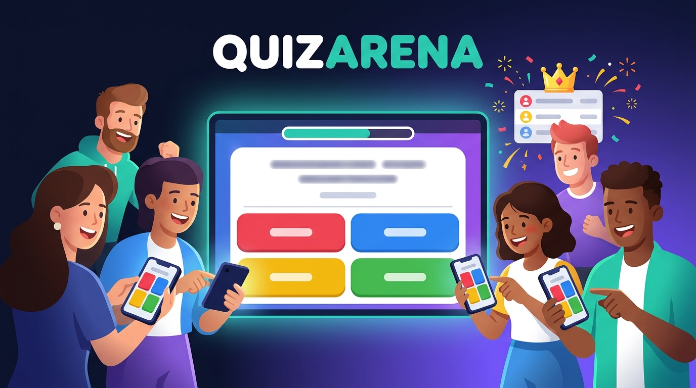

# QuizArena

A live multiplayer quiz game (think Kahoot) with a real backend: user accounts, a database,
server-authoritative real-time gameplay over WebSockets, a leaderboard, and an admin panel.

## Features

- **Accounts**: register / login, passwords hashed with bcrypt, JWT in an `httpOnly` cookie
- **Real-time games**: host creates a game and gets a 6-character code; players join from their own device
- **Server-authoritative**: the server holds the answers, runs the timer, measures answer speed and calculates every score. The client only ever says "I picked option 2"
- **Faster answers score more** (1000 points instantly, down to 500 at the deadline)
- **Reconnection**: refresh the page or lose connection mid-game and you land back in the same game
- **Leaderboard**: all-time and this week, plus per-user match history
- **Admin panel** (`/admin.html`): question CRUD, ban / promote users (bans kick live sockets immediately), usage stats
- **Security**: input validation (zod) on REST *and* socket events, rate limiting on auth and sockets, helmet headers, parameterised SQL, XSS-safe rendering
- **Tests**: scoring unit tests, API tests, and a full multi-player game over real WebSockets

## Quick start

Requires Node.js 22.13 or newer (it uses Node's built-in SQLite, so there is nothing native to compile).

```bash
npm install
cp .env.example .env     # then edit JWT_SECRET and admin credentials
npm run seed             # creates the admin user + sample questions
npm run dev              # http://localhost:3000
```

Log in with the admin credentials from `.env`, or register normal accounts. Open the game in two
browsers (or one normal + one private window): host a game in one, join with the code in the other.

```bash
npm test                 # run all tests
npm run make-admin -- someone@example.com   # promote an existing user
```

## Architecture

```
Browser (vanilla JS)  ──REST──►  Express  ──►  SQLite (users, questions, games, game_players)
        │                           │
        └────WebSocket────►  Socket.IO ──► GameManager (in-memory live games)
                                                  └── on game end: one DB transaction saves results
```

```
src/
  app.js            builds Express + Socket.IO (tests use this with an in-memory DB)
  server.js         starts listening
  config.js         environment config
  db.js             schema + connection
  auth.js           JWT cookie helpers, requireAuth / requireAdmin
  routes/           auth, public (leaderboard, history, categories), admin
  game/manager.js   the game state machine (lobby -> question -> reveal -> ... -> ended)
  game/scoring.js   pure scoring + ranking functions (unit tested)
  sockets.js        socket auth, validation, rate limiting, event wiring
public/             the frontend (no build step) and the admin panel
scripts/            seed + make-admin
tests/              node:test suites
```

### Socket events

| Direction | Event | Purpose |
|---|---|---|
| client → server | `game:create`, `room:join`, `game:start`, `room:leave`, `answer:submit` | all acknowledged with `{ ok, error? }` |
| server → client | `room:state` | lobby / players changed |
| server → client | `question:show` | question text + options + `endsAt` (never the answer) |
| server → client | `answer:count` | how many players have answered |
| server → client | `question:result` | correct answer + scoreboard |
| server → client | `game:end`, `game:cancelled`, `room:rejoined` | end screen / lobby closed / reconnect snapshot |

### REST API

| Method | Path | Auth |
|---|---|---|
| POST | `/api/auth/register`, `/api/auth/login`, `/api/auth/logout` | public (rate-limited) |
| GET | `/api/auth/me`, `/api/me/history` | logged in |
| GET | `/api/leaderboard?period=all\|week`, `/api/categories`, `/api/health` | public |
| GET/POST/PUT/DELETE | `/api/admin/questions[/:id]` | admin |
| GET / PATCH | `/api/admin/users[/:id]` | admin |
| GET | `/api/admin/stats` | admin |

## Design decisions

- **Server-authoritative game logic.** Anything the client sends can be forged, so the client never sends time or score and never receives the correct answer before the reveal. Tests assert this.
- **SQLite via Node's built-in `node:sqlite`.** Zero install, no native compilation, so anyone can clone and run it. The queries are plain SQL; moving to PostgreSQL means swapping the driver (`pg`) and `db.js`. (`node:sqlite` is still marked experimental in Node; the npm scripts silence that warning.)
- **JWT in an httpOnly cookie** rather than localStorage, so XSS can't steal the token. `SameSite=Lax` blocks cross-site form posts. The user is re-loaded from the DB on every request, so bans take effect instantly.
- **In-memory live games, persisted results.** Live game state changes many times a second and doesn't need to be durable; results are saved atomically in one transaction at the end.
- **No frontend framework / build step.** The point of the project is the backend. UI text is rendered with `textContent` only, never `innerHTML`.

## Known limitations / next steps

- **Single server only.** Live games are in one process's memory, so a restart ends running games and you can't run multiple instances. To scale out: Redis for game state + the Socket.IO Redis adapter, and sticky sessions.
- Swap SQLite for PostgreSQL for multi-instance deployments.
- Add email verification / password reset, and refresh-token rotation.
- Add CSRF tokens if you ever serve the API cross-origin.
- Ideas: question images, team mode, spectators, a React frontend, achievements.

## Deploy

**Docker**
```bash
JWT_SECRET=$(openssl rand -hex 32) ADMIN_PASSWORD='a-strong-password' docker compose up --build
```

**Render / Railway / Fly.io**: deploy the Dockerfile, set `JWT_SECRET`, `ADMIN_PASSWORD`, `TRUST_PROXY=1`, and
attach a persistent volume mounted at `/data` (otherwise the SQLite file is wiped on each deploy). WebSockets work out of the box on all three.
